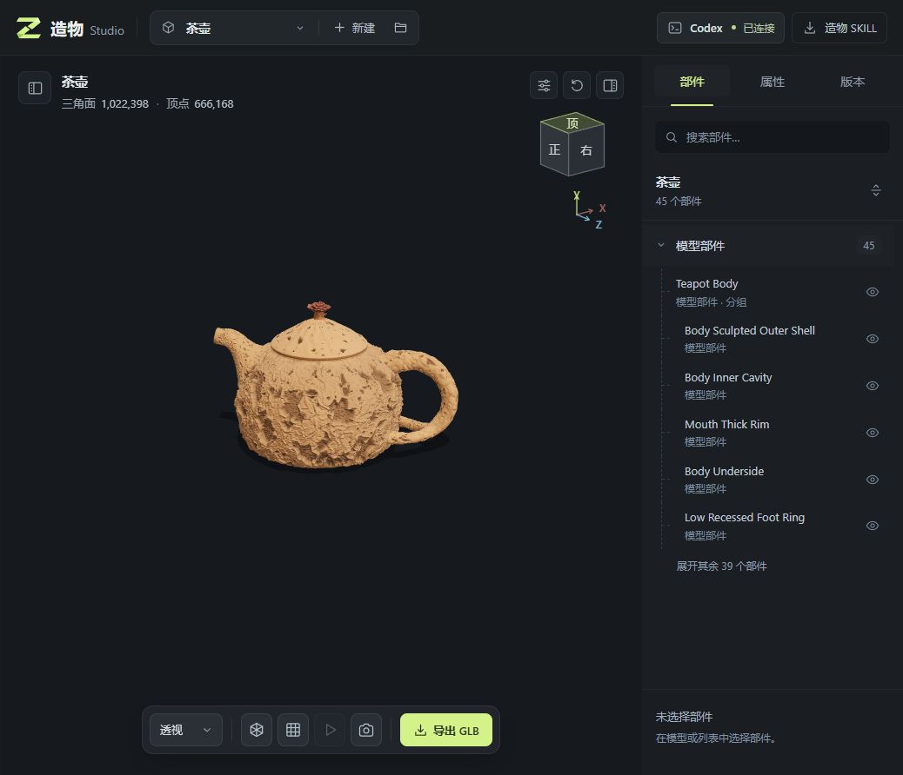
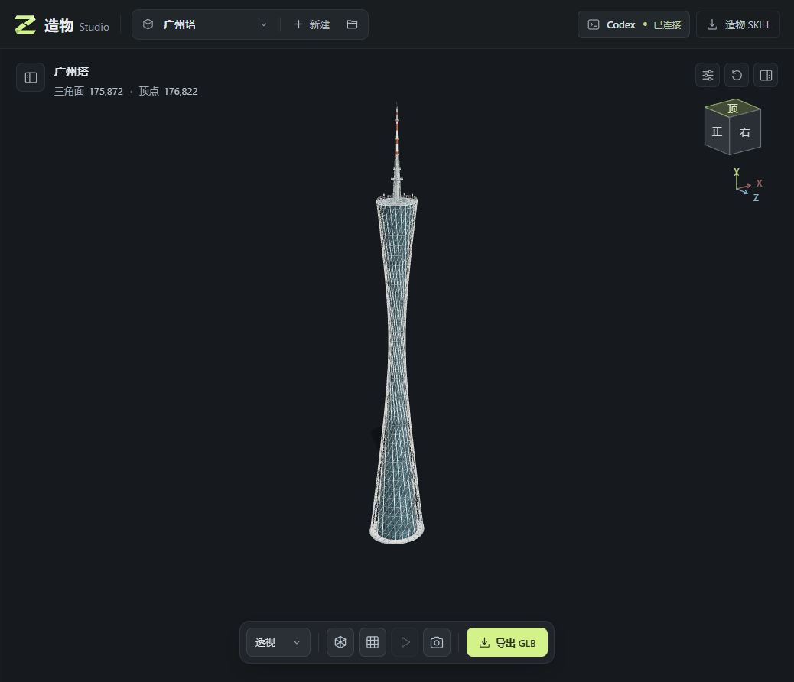
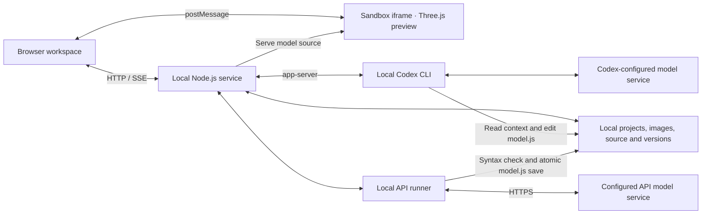

# Zaowu Studio · 造物 Studio

[简体中文](README.md) · [English](README.en.md)

**An MIT-licensed local workspace for Three.js modeling.** Generate model code from reference images and text through Codex CLI or a configured model API, then preview it in the browser, refine individual parts, browse versions, and export GLB. The construction logic stays in a readable, editable `model.js` file.

[Source on GitHub](https://github.com/ToBeMaster-Mao/zaowu-studio) · [MIT License](LICENSE) · [Illustrated walkthrough and model screenshots, in Chinese](docs/share/README.md) · [Sharing assets, in Chinese](docs/share/package-metadata.txt)

**Status: v0.1.0, experimental local application.** Zaowu supports local Codex CLI and API connections for OpenAI, DeepSeek, Gemini, and Grok (xAI) to generate Three.js geometry code. API mode does not require Codex. It does not include dedicated image-to-3D model weights. It is suited to experiments with everyday objects, regular shapes, architectural massing, and parametric models. Realistic people, complex organic forms, production-ready topology, and photorealistic reconstruction remain limitations. It does not promise to replace dedicated services such as Tripo, Meshy, or Rodin.

## Why model with code?

Shapes that can be described as parts, dimensions, curves, or repeated structures can be expressed in code and adjusted through further instructions. Zaowu brings that process into a workspace with previews and recoverable versions:

- **Editable source:** the Agent changes `model.js`; you can also read and edit its construction logic directly.
- **Context for revisions:** a conversation can include the selected part, camera view, viewport screenshot, and named groups of reference images to describe a local change.
- **Inspection and recovery:** inspect parts, adjust basic properties, and preview historical versions. A new version updates the current model after passing preview validation.
- **Export and reuse:** export the current or a historical version as GLB, while keeping the source and project data for further revisions.

Procedural code gives you a way to edit a model; it does not automatically provide correct proportions, realistic materials, or a production-ready asset. Project files are stored locally, while AI inference uses your configured Codex or API service. See [Local data and privacy](#local-data-and-privacy).

## Screenshots from the workspace

These images show actual model previews in the workspace. They illustrate the interface and example results, not a guarantee for arbitrary inputs. Polygon counts shown in the screenshots are not quality scores.

**Teapot: model preview and part inspection**



**Canton Tower: an architectural structure example**



## Quick start

You need Node.js **22 or later** and a modern browser with WebGL support. The same npm commands work on Windows, macOS, and Linux. For AI modeling, choose an authenticated Codex CLI or an API key for a supported service; API-only use does not require installing Codex.

1. Download the [repository source](https://github.com/ToBeMaster-Mao/zaowu-studio), or clone it and enter the directory:

```sh
git clone https://github.com/ToBeMaster-Mao/zaowu-studio.git
cd zaowu-studio
```

2. Run:

```sh
npm ci
npm start
```

Open [http://127.0.0.1:4174](http://127.0.0.1:4174). `npm start` first builds the downloadable Skill ZIP from source, then starts the local service. On Windows, after installing dependencies, you can also double-click `START-STUDIO.cmd`.

After opening the page, choose a modeling mode:

- **Codex CLI:** install the CLI using the [official Codex CLI instructions](https://learn.chatgpt.com/docs/codex/cli), run `codex login`, and connect it in the workspace. Codex manages authentication; see the [official authentication documentation](https://learn.chatgpt.com/docs/auth). If the connection fails, check that your CLI supports `codex app-server`.
- **Model API:** open **工作空间与模型服务** (Workspace and model services) in the top bar, enter the service's API key, fetch or type a model ID, and save. Select that service in the composer. API tasks can run while Codex is disconnected.

Existing local models can be browsed without connecting any model service. The workspace includes no model-service credits; Codex and each API service use their respective account permissions, allowances, and billing rules.

## Workspaces, model services, and concurrency

Top-bar settings let you enter an absolute local workspace path or return to a previously used directory. Switching opens the selected directory; **it does not move or delete projects in the old directory**. Finish or stop all running and queued tasks, and complete any pending model preview validation, before switching workspaces.

Codex and API concurrency limits are configured separately from **1 to 8**, both defaulting to **1**. The four API services share the API capacity. Different projects can submit tasks concurrently; excess tasks queue in first-in, first-out order within their category and can be cancelled before starting. A project can have only one running or queued task, and cannot be edited while its model awaits validation. After a restart, unfinished execution and queued tasks are recovered as interrupted; saved candidate models can still complete preview validation. **Model requests are not automatically resubmitted**, avoiding automatic duplicate calls.

API settings include an API key, Base URL, default model ID, and image-input switch. You can also choose the default model service. Model lists are fetched dynamically from the configured service rather than taken from a fixed built-in catalog. If a list is unavailable, enter the model ID manually. The composer lets you choose the service and model for the current task. Default addresses are:

| Service | Default Base URL |
| --- | --- |
| OpenAI | `https://api.openai.com/v1` |
| DeepSeek | `https://api.deepseek.com` |
| Gemini | `https://generativelanguage.googleapis.com/v1beta` |
| Grok (xAI) | `https://api.x.ai/v1` |

Custom addresses must use HTTPS; local addresses may use HTTP. Usernames, passwords, query parameters, and fragments are not allowed. **Fetching models and testing a connection both make only GET requests to the model-list endpoint; neither starts a generation task.** A successful test confirms access to the model list, not generation permissions, available balance, image support, or modeling quality for the selected model.

Set the image-input switch to match the actual model. Enabling it cannot add capabilities that the model does not have. A text-only configuration rejects tasks containing images rather than dropping images and continuing. Leave the API key field blank to keep the saved key; choose **清除已保存的密钥** (Clear saved key) to remove it.

### Optional configuration

| Environment variable | Purpose |
| --- | --- |
| `STUDIO_PORT` | Local HTTP port; defaults to `4174` |
| `STUDIO_DATA_DIR` | Initial workspace directory; defaults to `.studio/projects` in this repository. Once settings are saved, their workspace selection takes precedence. |
| `STUDIO_SETTINGS_PATH` | Absolute local settings-file path; must be outside the workspace |
| `CODEX_BIN` | Path to the Codex executable when it is not available on PATH |

For example, in Windows PowerShell:

```powershell
$env:STUDIO_PORT = '4180'
npm start
```

On macOS / Linux:

```sh
STUDIO_PORT=4180 npm start
```

The service listens on the local loopback address. This version is not intended to be exposed directly to the public internet.

Without `STUDIO_SETTINGS_PATH`, settings are stored in the repository's `.studio/settings.json`. When `STUDIO_DATA_DIR` is specified, the default settings path instead appends `.settings.json` to that directory's absolute path: `${root}.settings.json`. Changing `STUDIO_DATA_DIR` therefore changes the default settings-file location. Within a given settings file, a saved workspace selection takes precedence over the initial directory value.

## Architecture and workflow

The browser workspace handles images, conversations, task status, and project actions. A separate sandbox iframe runs the Three.js preview. The Node.js service manages local projects and task queues, uses Codex's `app-server` or the API runner according to the selected mode, and sends results and progress to the page over HTTP / SSE.



1. Select a project, model service, and images for this task. Start modeling a new subject, or describe a change to the current model.
2. The server validates the request and image references, prepares `task-context.json`, and queues the task. Local edits can include the selected part, camera, and current screenshot.
3. Codex reads the project instructions, Skill, and task context to edit `model.js`. The API runner instead sends the complete current task context, current source, project instructions, Skill, model contract, and exact image inputs to the model. API models have no terminal or file tools and must return the complete `model.js` source; a question-only answer can leave the source unchanged.
4. When the task ends, the service checks for source changes. If there is a new model, it creates a pending version and loads it in the viewport for validation.
5. A version that passes preview validation becomes available; a failed version leaves the previous valid model intact. Continue editing parts or export GLB.

API-generated source first passes a JavaScript syntax check that does not execute the code, then atomically replaces the working file before entering the same version and preview-validation workflow. Truncated or malformed output, cancellation, or an intervening source edit prevents that output from overwriting the current file.

This workflow checks whether a model can load and preview. It does not automatically assess visual similarity, engineering accuracy, or topology quality. Project storage and preview run locally; model requests go to the selected service.

## Create a model and continue editing

The current workspace interface uses Chinese labels; key labels are included below to help you find the controls.

- Use the top `＋` button to create an independent project. Uploading images saves them to the current project; it does not create another project.
- Project references support PNG, JPEG, and WebP, up to **12 MiB per image**. Select or drag in multiple images. The project library holds up to **128 images**.
- Select reference images and click **开始建模** (Start modeling). Text is optional. This rebuilds the project's subject from the selected images; previous models remain accessible in the version history.
- In a conversation, **添加图片** (Add images), drag-and-drop, or paste appends images to the ordinary attachment area. To separate purposes, explicitly choose **添加图片组** (Add image group), then use its `＋` button or drop images into it. Name groups by purpose, such as “front, side, and back views,” “handle details,” or “materials.” A task allows up to **8 groups**, including the ordinary attachment area. Empty groups are not sent.
- A task can include up to **16 distinct images** across project references and conversation attachments. An image reused across groups is passed to the model only once. The current viewport screenshot for a local edit is identified separately and is not a target reference image.
- API mode accepts up to **17 images** (16 user images plus one viewport screenshot), at most **10 MiB each**. The full request, including text, source, and base64-encoded images, is limited to **18 MiB**. The library's 12 MiB upload limit does not mean every saved image can be sent directly to an API. Compress or reduce oversized inputs; images are not silently discarded. The selected model may impose stricter capability or size limits.
- Before sending, check whether the selected project references should be included. Historical messages retain their images and grouping; removing an image from the library does not erase a sent attachment.
- The status panel shows queuing, startup, processing, approval, stopping, validation, completion, or failure. Codex operations requiring permission appear in the interface. Stopping a running task waits for its runner to confirm; a queued task can be cancelled directly.

Modeling a new subject does not include the old viewport screenshot, selected part, or property overrides. A continuing conversation can include the current part selection, camera, properties, and viewport screenshot to support local edits.

## Preview, versions, and export

The viewport supports drag-to-orbit, scroll-to-zoom, part selection, wireframe, a grid, and playback of existing animations. The view cube and XYZ axes at the upper right follow the actual camera; click a visible cube face to switch direction. Reset-view and part-panel controls sit on the same upper row, with keyboard support. The model convention uses **−X as the front direction**.

The **部件** (Parts) tab supports search, group expansion, and visibility toggles. **属性** (Properties) lets you change the selected part's color, position, and visibility. `Ctrl / Cmd + K` focuses part search; `Ctrl / Cmd + Enter` sends the conversation input.

In **版本** (Versions), **预览此版本** (Preview this version) changes only what is displayed, not the working version. **返回当前版本** (Return to current version) leaves the read-only preview. Only **恢复此版本** (Restore this version) changes the current working version. You can browse history while a task runs, but restoring or editing is blocked. When a new model enters validation, the workspace returns to the current version. Loading or validation failures preserve the previous valid model.

**导出 GLB** (Export GLB) exports the displayed model and its existing animations. Historical previews can also be exported independently. Exported files are also saved in the project's `exports/` directory.

## Local data and privacy

Project files are stored by default in `.studio/projects/<project-id>/`:

| Path | Contents |
| --- | --- |
| `work/model.js` | Current editable model source |
| `work/task-context.json` | This task's request, image groups, selection, and camera context |
| `work/references/` | Uploaded images and viewport screenshots used by tasks |
| `work/.agents/skills/model-studio/` | Modeling instructions used by this project |
| `versions/` | Version snapshots of model source and property overrides |
| `project.json` | Conversations, task state, image indexes, and version metadata |
| `exports/` | Exported GLB files |

“Stored locally” describes where project files live; **it does not mean AI inference runs offline**. Codex mode gives Codex the selected images, text, applicable viewport screenshot, and project context. Its configuration determines where requests go; source files and tool results read during the task, and history from a continued conversation, may also be processed. In API mode, the local service directly sends the complete task context, current source, modeling instructions, and current image inputs, including a bounded recent conversation where applicable. Submit only content you have the right to use and permission to send to the configured service.

Codex still manages its own login credentials. API keys are entered in settings and saved in a local settings file separate from project directories; that file cannot be placed inside the workspace. Public settings responses expose only `hasApiKey`, never the saved key. The backend attaches the key to API requests rather than including it in model prompts.

Settings are saved atomically. Windows uses a file ACL granting access only to the current user; POSIX uses `0600` permissions. **File permissions are not encryption:** local programs with permission to read the file can obtain the keys. Windows saves fail if those permissions cannot be set. A damaged settings file is not automatically reset, preserving the existing credentials.

The repository ignores project data, logs, test output, design-process files, and generated ZIPs by default. Still inspect staged files, especially settings saved to a custom location. Do not attach `.studio`, settings files, credentials, or conversations containing images to public issues.

To back up a project, copy its data directory after stopping tasks and the service. A GLB export does not contain the complete source, conversation, or version history and is not a substitute for a project backup.

## Skill and model contract

Open **造物 SKILL** in the top bar and choose **复制 Agent 安装指令** (Copy Agent installation instructions). Paste the instructions into a local Codex, Claude Code, or other Skill-capable Agent conversation so the Agent can download and install the Skill. The instructions use the running service's actual address without requiring a token. Keep Zaowu running during the download; the address is accessible only on the same computer. You can also choose **下载 ZIP** (Download ZIP) for manual installation, or run:

```sh
npm run pack:skill
```

The output is `public-downloads/model-studio-skill.zip`, containing the complete `model-studio/` Skill directory. Default personal installation directories are `~/.agents/skills/` for Codex and `~/.claude/skills/` for Claude Code; use an existing valid custom directory if configured. After installation, invoke `$model-studio` in Codex and provide the project directory, images, and requirements. Other Agents use their own Skill invocation method. See [INSTALL.md, in Chinese](studio-skill/model-studio/INSTALL.md) for the full steps.

Projects created by the workspace already contain a project-level Skill, so no additional installation is needed for built-in Codex or API mode; API requests include the Skill's contents. The Skill supplies modeling and validation instructions, and the runner handles communication. Downloading or installing the Skill does not log in, install or start an Agent, or start modeling automatically.

Model entry point:

```js
import * as THREE from 'three';

export function createModel() {
  const root = new THREE.Group();
  // Add Mesh / Group objects with stable names.
  return { root, animations: [] };
}
```

Model code runs in a separate sandbox iframe and uses only permitted `three` / `three/addons/` imports. Do not put network requests, filesystem access, process operations, or page UI code in a model. See the [model contract, in Chinese](studio-skill/model-studio/references/model-contract.md).

## Development and checks

```sh
npm run check
npm test
npm run pack:skill
npm run test:ui
```

- `check`: checks JavaScript syntax and package-metadata consistency.
- `test`: runs all `*.test.mjs` unit tests with simulated Codex and API responses, without calling real models. It removes inherited `STUDIO_TEST_ORIGIN` to avoid accidentally enabling live tests.
- `test:ui`: starts an independent in-memory fixture at [http://127.0.0.1:4176](http://127.0.0.1:4176). Simulated tasks exercise image groups, status feedback, stopping, approvals, and versions. It neither changes real projects nor calls Codex.
- `smoke:http`: checks the APIs of an already running local workspace; start the service separately, then run `npm run smoke:http`.

`studio-server/integration-run.mjs` is a live model-integration script. It creates projects and consumes the current Codex account's usage allowance. It is excluded from the default tests and CI; understand its purpose before running it. CI runs checks, unit tests, and Skill packaging with Node.js 22 on Windows, macOS, and Linux. Browser behavior and live model integration still require manual verification.

### Repository layout

| Directory / file | Responsibility |
| --- | --- |
| `studio-web/` | Workspace interface, images, conversation, task status, versions, and properties |
| `studio-viewer/` | Three.js rendering, selection, camera controls, model validation, and GLB export |
| `studio-server/server.mjs` | Local HTTP / SSE APIs and task coordination |
| `studio-server/codex-bridge.mjs` | Codex app-server process and protocol communication |
| `studio-server/api-provider.mjs` | API model lists, connection tests, multimodal generation, and validated source saving |
| `studio-server/settings-store.mjs` | Local workspace, service configuration, and credential storage with redacted public reads |
| `studio-server/task-scheduler.mjs` | Project exclusivity, separate Codex / API concurrency limits, and task queues |
| `studio-server/project-store.mjs` | Persistence for projects, images, conversations, versions, and overrides |
| `studio-server/task-contract.mjs` | Input validation, image-group mapping, and model-task context |
| `studio-skill/model-studio/` | Distributable Skill source |
| `scripts/` | Cross-platform checks, test entry point, and ZIP packaging |
| `model.js` | Procedural airliner example source; original private reference images are not included |

## Current limitations

Start with shapes that can be described through parts, dimensions, and repeated structures: everyday objects, regular shapes, architectural massing, and parametric forms. Structures hidden in a reference image require approximation. There is no guarantee of recovering complete, accurate geometry from a single photograph.

Each project uses a single `model.js` entry point and processes one task at a time; multiple projects can run within the configured Codex / API concurrency limits. API integration does not guarantee that every model supports images or the required structured output, and custom addresses must implement the selected service's API. This version does not provide accounts, multi-user collaboration, billing, public hosting, dedicated image-to-3D inference, automatic rigging, or a complete digital content creation (DCC) editor. A high polygon count does not imply high quality. Human proportions, clothing, textures, and topology still need a dedicated asset workflow.

Realistic people and complex organic models usually require additional modeling, retopology, UV work, materials, rigging, and asset validation. Zaowu does not promise production-ready topology or a replacement for Tripo, Meshy, Rodin, or professional DCC tools.

Browser isolation, input validation, and loopback binding limit the scope of accidental operations; they are not a security guarantee against arbitrary malicious model code. Review the source and Agent permissions before running an unfamiliar project. See [SECURITY.md](SECURITY.md) for security reporting and [CONTRIBUTING.md](CONTRIBUTING.md) for contributions.

## License

The project source is available under the [MIT License](LICENSE). Third-party dependencies retain their own licenses. The repository license does not automatically change rights to reference images, user inputs, or generated assets. This is not an official product of OpenAI, Three.js, Tripo, Meshy, or Rodin.
