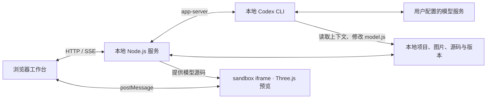

# 造物 Studio · Zaowu Studio

[简体中文](README.md) · [English](README.en.md)

**MIT 开源的本地 Three.js 建模工作台。** 让 Codex 根据参考图片和文字编写模型代码，在浏览器里预览、按部件继续修改、浏览版本并导出 GLB。模型的构造逻辑保留在可阅读、可修改的 `model.js` 中。

[GitHub 源码](https://github.com/ToBeMaster-Mao/zaowu-studio) · [MIT License](LICENSE) · [图文介绍与实际模型截图](docs/share/README.md) · [分享素材说明](docs/share/package-metadata.txt)

**状态：v0.1.0，实验性本地应用。** 造物通过本地 Codex CLI 连接模型服务，让 Agent 编写 Three.js 几何代码；项目不包含专用图生 3D 模型权重。适合尝试器物、规则物体、建筑体块和参数化模型。写实人物、复杂有机形体、生产级拓扑与照片级还原仍是短板，不承诺替代 Tripo、Meshy、Rodin 等专用服务。

## 为什么用代码建模

当形状能拆成部件、尺寸、曲线或重复结构时，可以把它们表达为代码，再按要求继续调整。造物把这个过程放进一个可预览、可回退的工作台：

- **保留可编辑源码**：Agent 修改 `model.js`；你也可以直接阅读和修改模型的构造逻辑。
- **带着上下文修改**：对话可附上选中部件、当前视角、截图和多组参考图片，便于描述局部修改。
- **检查与回退**：查看部件、调整基础属性，预览历史版本；新版本通过预览校验后更新当前模型。
- **交付与复用**：导出当前或历史版本的 GLB；保留源码和工程数据，继续迭代。

程序化表达提供了修改入口，不等于自动获得正确比例、真实材质或生产可用资产。项目文件保存在本地，AI 推理仍使用你为 Codex 配置的服务，详见[本地数据与隐私](#本地数据与隐私)。

## 实际工作台截图

以下图片来自实际工作台中的模型预览，展示界面与示例结果；它们不是对任意输入效果的承诺，截图中的面数也不是质量评分。

**茶壶：模型预览与部件检查**


**广州塔：建筑结构示例**


## 快速开始

需要 Node.js **22 或更新版本**、支持 WebGL 的现代浏览器，以及已安装并完成登录的 Codex CLI。Windows、macOS、Linux 使用相同的 npm 命令。

1. 按 [Codex CLI 官方安装说明](https://learn.chatgpt.com/docs/codex/cli)安装 CLI，在终端运行 `codex login` 完成登录。登录方式由 Codex 管理，参见[官方身份验证说明](https://learn.chatgpt.com/docs/auth)。
2. 下载[仓库源码](https://github.com/ToBeMaster-Mao/zaowu-studio)或克隆仓库，进入 `zaowu-studio` 文件夹：

```sh
git clone https://github.com/ToBeMaster-Mao/zaowu-studio.git
cd zaowu-studio
```

3. 运行：

```sh
npm ci
npm start
```

打开 [http://127.0.0.1:4174](http://127.0.0.1:4174)。`npm start` 会先从源码生成可下载的 Skill ZIP，再启动本地服务。Windows 完成依赖安装后，也可以双击 `START-STUDIO.cmd`。

网页可以在未连接 Codex 时浏览本地模型；开始 AI 建模前需要连接成功。平台使用你已有的 Codex 登录方式和相应额度，不附带模型服务额度。Codex 的 `app-server` 协议仍在演进；连接失败时，先检查 CLI 是否支持 `codex app-server`。

### 可选配置

| 环境变量 | 用途 |
| --- | --- |
| `STUDIO_PORT` | 本地 HTTP 端口，默认 `4174` |
| `STUDIO_DATA_DIR` | 项目数据根目录，默认仓库中的 `.studio/projects`；建议使用绝对路径 |
| `CODEX_BIN` | CLI 不在 PATH 中时，指定 Codex 可执行文件路径 |

例如 Windows PowerShell：

```powershell
$env:STUDIO_PORT = '4180'
npm start
```

macOS / Linux：

```sh
STUDIO_PORT=4180 npm start
```

服务监听本机回环地址。当前版本不用于直接暴露到公网。

## 架构与工作流程

浏览器工作台负责图片、对话、任务状态和项目操作；独立的 sandbox iframe 负责 Three.js 预览。Node.js 服务管理本地工程，通过 Codex 的 `app-server` 与 Agent 通信，并使用 HTTP / SSE 将结果和进展送回页面。



1. 选择项目和本轮参考图，开始新主体建模，或输入针对当前模型的修改要求。
2. 服务端校验图片与请求，整理 `task-context.json`；局部修改可附带选中部件、视角和当前截图。
3. Codex 读取工程约定、Skill 和任务上下文，修改 `model.js`；进展与需要确认的操作显示在工作台。
4. 任务结束后，服务检查源码变化；有新模型时建立待校验版本，并让视口加载预览。
5. 新版本通过预览检查后成为可用版本；校验失败时保留上一有效模型。继续按部件修改，或导出 GLB。

这条流程检查模型能否加载和预览，不会自动判定外观还原程度、工程精度或拓扑质量。项目存储与预览在本机完成，Codex 的模型调用遵循其配置。

## 创建与继续修改

- 顶部 `＋` 创建独立项目。上传图片会保存到当前项目，不会自动新建项目。
- 项目参考图支持 PNG、JPEG、WebP，单张最多 **12 MiB**；可以多选或拖动多张图片上传。图库最多保存 **128 张**。
- 勾选参考图后点击 **开始建模**，文字可以留空。这会按本次选图重建当前项目主体；旧模型仍可在版本记录中查看。
- 继续对话时，点击「添加图片」、拖入或粘贴会追加到普通附件区；需要区分用途时，手动点击「添加图片组」，再通过组内「＋」或拖入图片，为其命名如“正侧背视图”“杯柄细节”“材质参考”。每轮最多 **8 组**（普通附件区占一组），空组不会发送。
- 每轮项目参考图和补充图片合计最多 **16 张不同图片**；跨组复用同一张图只作为一个图像输入。用于局部修改的当前视口截图另行标记，不算作目标参考图。
- 发送前确认是否同时带上已选项目参考图。历史消息会保留本轮图片及组别，之后从图库移除图片不会抹去已发送附件。
- 状态面板显示启动、处理、待确认、停止、校验、完成或失败。需要操作许可时，界面会显示确认入口；停止操作会等待 Agent 返回结果。

新主体建模不携带旧模型截图、旧部件选择或属性覆盖。继续对话可以携带当前选中部件、相机、属性和视口截图，方便局部修改。

## 预览、版本与导出

视口支持拖动旋转、滚轮缩放、点击部件、线框、网格和已有动画播放。右上角视角立方体及 XYZ 坐标轴随实际相机转动，点击立方体可见面可切换对应方向；上方同排放置复位与部件面板按钮，也支持键盘操作。模型约定以 **−X 为正面**。

右侧“部件”支持搜索、分组展开和显示/隐藏；“属性”可调整所选部件的颜色、位置和可见性。`Ctrl / Cmd + K` 聚焦部件搜索，`Ctrl / Cmd + Enter` 发送对话。

在“版本”中，**预览此版本**只切换展示，不改变工作版本；**返回当前版本**退出只读预览；**恢复此版本**才会切换当前工作版本。任务运行时允许浏览历史，但禁止恢复或编辑；新模型进入校验时会回到当前版本。加载或校验失败时保留上一份有效模型。

**导出 GLB** 导出当前展示的模型及已有动画；历史预览也可单独导出。导出文件同时保存在该项目的 `exports/` 目录中。

## 本地数据与隐私

项目文件默认保存在 `.studio/projects/<项目 ID>/`：

| 路径 | 内容 |
| --- | --- |
| `work/model.js` | 当前可编辑模型源码 |
| `work/task-context.json` | 本轮要求、图片分组、选择和视角上下文 |
| `work/references/` | 上传的图片和任务使用的视口截图 |
| `work/.agents/skills/model-studio/` | 当前工程使用的建模规范 |
| `versions/` | 模型源码及属性的版本快照 |
| `project.json` | 对话、任务状态、图片索引和版本元数据 |
| `exports/` | 导出的 GLB 文件 |

“保存在本地”指项目文件的存储位置，**不表示 AI 推理离线进行**。开始任务后，本轮所选图片、文字、适用的视口截图和工程上下文会交给 Codex；Codex 会按用户的模型与服务配置发送请求，执行任务时读取的源码、工具结果，以及续接对话的历史上下文也可能参与处理。请仅提交有权使用、允许发送给相应服务的内容。

登录凭据由 Codex 自己管理，工作台不要求将账号令牌粘贴到网页。仓库默认忽略项目数据、日志、测试输出、设计过程文件和生成压缩包；提交前仍需检查暂存文件。不要把 `.studio`、凭据或带图片的对话记录附到公开 Issue。

备份时复制项目数据目录；关闭任务和服务后再操作。导出的 GLB 不包含完整的源码、对话或版本历史，不能替代工程备份。

## Skill 与模型约定

在顶部打开「造物 SKILL」，点击「复制 Agent 安装指令」，粘贴到本机 Codex、Claude Code 或其他支持 Skills 的 Agent 对话中，由 Agent 下载并安装。指令使用当前服务的实际地址，无需令牌；下载期间保持造物运行，该地址仅在本机可用。也可以点击「下载 ZIP」手动安装，或执行：

```sh
npm run pack:skill
```

输出为 `public-downloads/model-studio-skill.zip`，完整技能目录为 `model-studio/`。个人安装目录默认是 Codex 的 `~/.agents/skills/`、Claude Code 的 `~/.claude/skills/`；已有有效自定义目录时使用其实际配置。安装后，在 Codex 中使用 `$model-studio` 并提供工程目录、图片和要求；其他 Agent 使用各自的技能调用方式。完整步骤见 [INSTALL.md](studio-skill/model-studio/INSTALL.md)。

平台新建的建模工程已自带项目级技能，使用内置 Codex 连接时无需额外安装。Skill 提供建模与校验规范，本地连接程序负责通信；下载或安装 Skill 不会自动登录、安装或启动 Agent，也不会自动开始建模。

模型入口：

```js
import * as THREE from 'three';

export function createModel() {
  const root = new THREE.Group();
  // 添加具有稳定名称的 Mesh / Group。
  return { root, animations: [] };
}
```

模型代码在独立的 sandbox iframe 内执行，仅使用允许的 `three` / `three/addons/` 依赖。请勿在模型中编写网络请求、文件系统、进程或页面 UI 操作。详细约定见 [model-contract.md](studio-skill/model-studio/references/model-contract.md)。

## 开发与检查

```sh
npm run check
npm test
npm run pack:skill
npm run test:ui
```

- `check`：检查 JavaScript 语法及包元数据一致性。
- `test`：运行所有 `*.test.mjs` 单元测试；不连接真实 Codex，并屏蔽继承的 `STUDIO_TEST_ORIGIN`，以免意外触发在线测试。
- `test:ui`：在 [http://127.0.0.1:4176](http://127.0.0.1:4176) 启动独立内存场景，用模拟任务检查图片组、状态反馈、停止、审批与版本交互。它不修改真实项目、不调用 Codex。
- `smoke:http`：检查已经启动的本地工作台接口，需单独运行服务。

`studio-server/integration-run.mjs` 是真实模型联调脚本，会创建项目并消耗当前 Codex 账户额度，未包含在默认测试与 CI 中。不要在不了解用途时执行。CI 在 Windows、macOS 和 Linux 上运行 Node.js 22 的检查、单元测试和 Skill 打包；浏览器和真实模型联调仍需人工验证。

### 代码结构

| 目录 / 文件 | 职责 |
| --- | --- |
| `studio-web/` | 工作台界面、图片与对话、任务状态、版本和属性面板 |
| `studio-viewer/` | Three.js 渲染、选择、视角控件、模型校验和 GLB 导出 |
| `studio-server/server.mjs` | 本地 HTTP / SSE 接口及任务协调 |
| `studio-server/codex-bridge.mjs` | Codex app-server 的进程与协议通信 |
| `studio-server/project-store.mjs` | 项目、图片、对话、版本和属性持久化 |
| `studio-server/task-contract.mjs` | 输入校验、图片组映射和模型任务上下文 |
| `studio-skill/model-studio/` | 可分发的 Skill 源码 |
| `scripts/` | 跨平台检查、测试入口和 ZIP 打包 |
| `model.js` | 程序化客机示例源码，不包含原始私人参考图 |

## 当前边界

更适合从可描述的部件、尺寸和重复结构入手，例如器物、规则物体、建筑体块与参数化形状。参考图片未显示的结构需要近似处理；这里没有从单张照片恢复真实完整几何的保证。

同一时刻运行一个建模任务，项目以单个 `model.js` 为入口。尚未提供账号系统、多人协作、计费、公共托管、专用图片转 3D 推理服务、自动绑骨或完整 DCC 编辑能力。高面数不等于高质量，人物比例、衣物结构、贴图和拓扑仍需要专门的资产流程。

写实人物与复杂有机模型通常需要额外的建模、重拓扑、UV、材质、绑定和资产验证工作。造物不承诺直接产出生产级拓扑，也不承诺替代 Tripo、Meshy、Rodin 或专业 DCC 工具。

浏览器隔离、输入校验和本地监听降低误操作范围，但不构成对任意恶意模型代码的安全承诺。运行来源未知的项目之前，应先审查源码和 Agent 权限。安全问题见 [SECURITY.md](SECURITY.md)，贡献方式见 [CONTRIBUTING.md](CONTRIBUTING.md)。

## 许可

本项目源码采用 [MIT License](LICENSE)。第三方依赖各自遵循其许可证；参考图片、用户输入和生成资产的权利不因本仓库许可证而自动改变。本项目不是 OpenAI、Three.js、Tripo、Meshy 或 Rodin 的官方产品。
