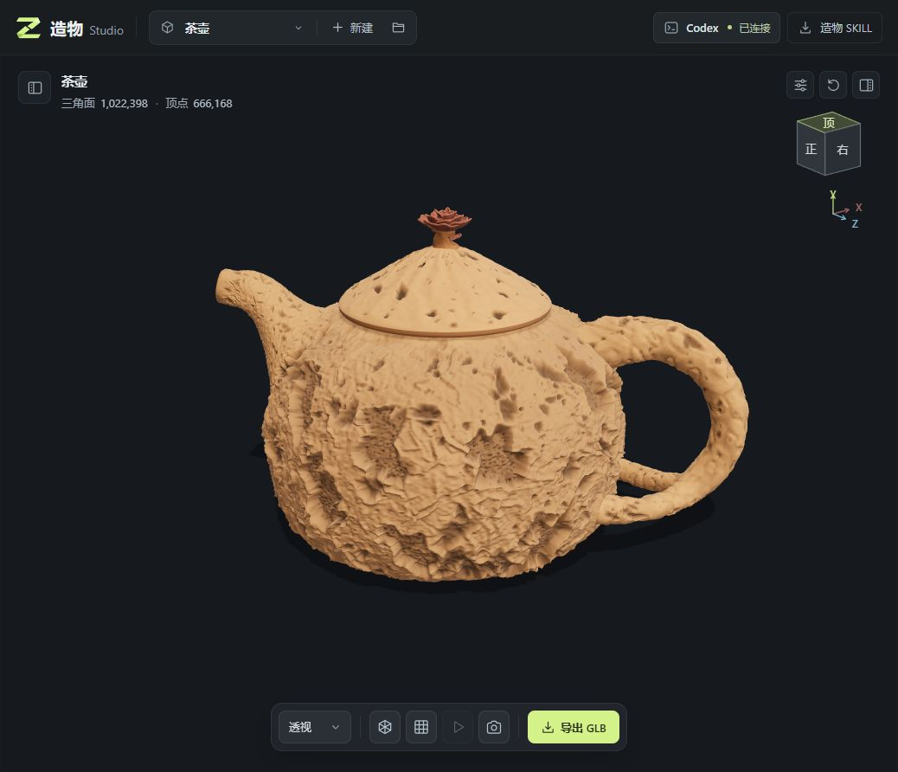
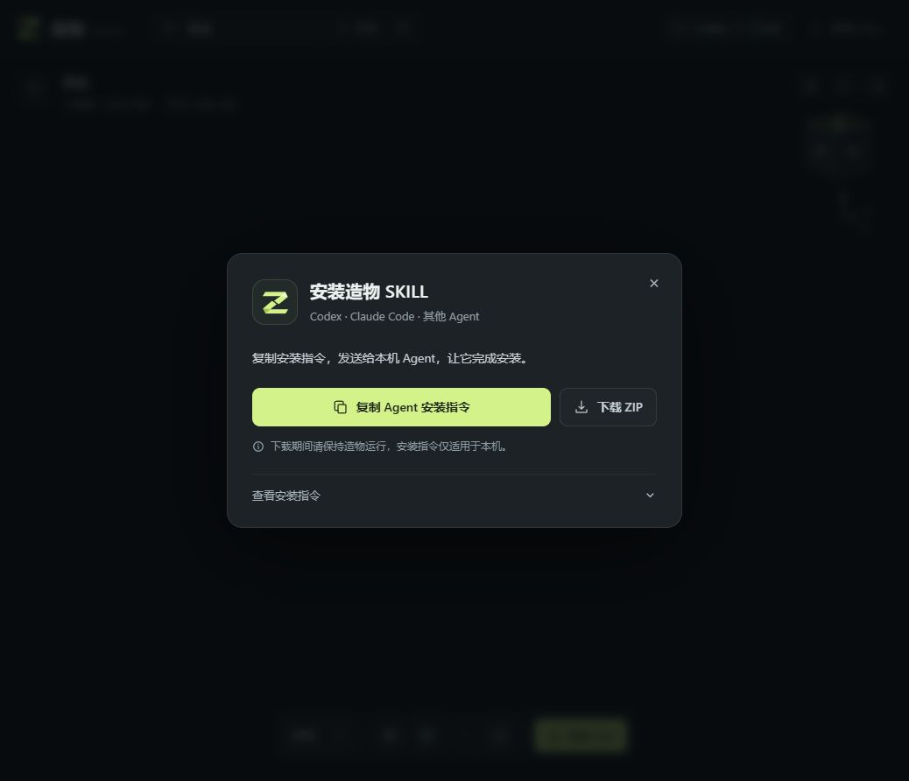

# 造物 Studio：把本地 Codex 接进三维建模工作台



这两天做了一个本地三维建模工作台，叫 **造物 Studio**。上传参考图，让 Agent 生成模型之后，还能在同一个界面查看结果、选中部件继续修改、回看历史版本，最后导出 GLB。

这次主要尝试了广州塔、茶壶、盆栽等对象。下面这些是造物实际生成并加载的模型截图。


## 两种使用方式

### 1. 在造物里连接本地 Codex CLI

造物通过本地连接程序与 **Codex CLI 的 app-server** 通信，使用电脑上已有的 Codex 登录。

上传并勾选参考图，点击“开始建模”，任务就会交给 Codex。它根据要求修改当前工程的 `model.js`，工作台再加载、校验和展示结果。只上传图片也能开始，文字并非必填。

继续修改时，可以选中某个部件，补充文字或几组细节图，比如“缩小壶盖”“调整壶嘴连接处”。当前部件、视角和图片上下文可以一起交给 Agent，不必每次从头描述。

这条流程会为工程自动准备造物 SKILL，不需要先单独安装个人技能。

### 2. 在 Codex 或其他 Agent 里使用造物 SKILL

也可以打开顶部的 **造物 SKILL**，点击“复制 Agent 安装指令”，把内容粘贴给 Codex，让它下载并安装；或者下载 ZIP 手动安装。



安装指令里的下载地址来自本机造物，因此需要在运行造物的同一台电脑上下载，并保持服务运行。换到云端 Agent 或其他电脑时，应传递下载好的技能包，不能直接使用这个本机地址。

安装后，在 Codex 中提供实际工程目录、参考图和要求，例如：

```text
使用 $model-studio，在我指定的造物工程里参考这些图片制作茶壶。
壶身、壶盖、壶嘴和把手分别分组，方便后续调整。
```

其他支持 Skills 的 Agent 也可以按自身的安装和调用方式使用这份技能。它约定了 Three.js 模型入口、部件组织、修改和验证方式；指定造物工程后，Agent 可以直接编辑本地模型，由工作台检测变化并预览。

目前平台内置的直接连接针对 Codex CLI。安装 SKILL 本身不会把其他 Agent 自动接入平台，也不附带模型服务或额度。

## 现在能做什么

- 多张参考图上传、拖拽上传，继续会话时附上多组补充图片。
- 旋转、缩放和选择模型部件，调整颜色、位置及显示状态。
- 切换深浅背景、白模、线框和网格，查看部件展开、合拢动效。
- 预览历史版本，确认后恢复；也能单独导出正在查看的版本。
- 导出 GLB，用于后续网页展示或其他三维工具。

版本预览只切换展示，确认恢复后才改变当前工作版本，比较不同方案时更方便。部件展开、白模和背景切换用于查看模型，不会改写原模型的材质与结构。

## 试下来的一些体会

建筑、器物和规则结构比较适合这套方式；人物、衣物和复杂有机形体，目前还有明显差距。造物采用的是让 Agent 编写 Three.js 几何代码的方式，没有内置专用图片转 3D 模型权重，不能把它当成精确扫描或照片级重建工具。

项目文件保存在本地，AI 请求仍由所连接的 Agent 服务处理。生成结果也需要结合实际用途检查比例、结构和细节。

## 启动与仓库

准备 Node.js 22 或更新版本，安装并登录 Codex CLI，下载仓库后在项目目录运行：

```sh
npm ci
npm start
```

打开 `http://127.0.0.1:4174` 即可使用。未连接 Codex 时，也可以浏览已有的本地模型。

- [团队仓库：3k-development/zaowu-studio](http://192.168.17.55:3001/3k-development/zaowu-studio)
- [GitHub：ToBeMaster-Mao/zaowu-studio](https://github.com/ToBeMaster-Mao/zaowu-studio)

团队仓库需要内网访问，GitHub 仓库目前为私有，需要相应访问权限。欢迎大家拿自己的参考图试一试，也欢迎反馈建模效果和操作上的问题。
